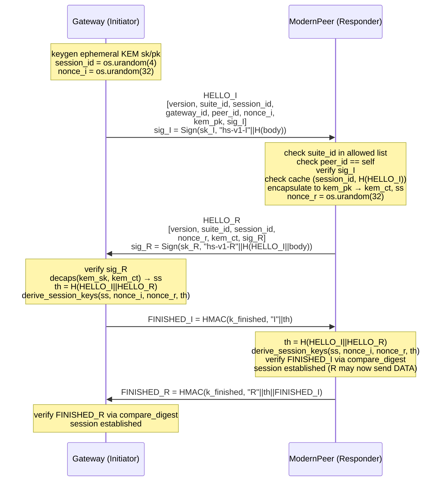
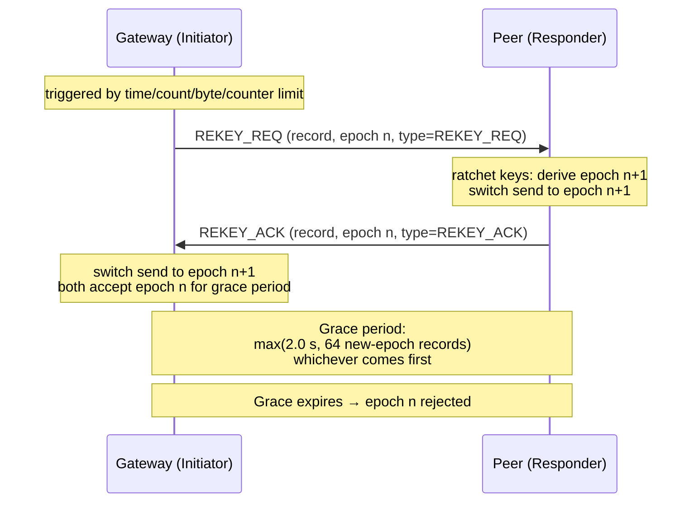

# Protocol Specification

This document describes the wire protocol as implemented in the code. Where CLAUDE.md and
the code differ, this document follows the code and notes the discrepancy.

**Implementations:** `src/pqcgw/protocol/` and `src/pqcgw/nodes/`.

---

## 1. Link message prefix (C1–C3 only)

Every message on the network link in configurations C1–C3 starts with a 1-byte type field.
C0 (passthrough) carries no prefix.

| Byte | Message |
|---|---|
| `0x01` | HELLO_I |
| `0x02` | HELLO_R |
| `0x03` | FINISHED_I |
| `0x04` | FINISHED_R |
| `0x10` | DATA (record layer) |

The prefix is **not** covered by AEAD or any signature. Altering it only misroutes the
message; the receiver then rejects it at the parse or authentication step. `session_id` is
in the authenticated record header (AEAD AAD), so a DATA record cannot be accepted under a
different session by prefix modification. Messages shorter than the minimum length for
their type, or with an unknown prefix byte, are dropped and counted as `malformed_drops`.

Source: `gateway.py` and `peer.py` constants `_T_HELLO_I … _T_DATA`.

---

## 2. Handshake messages

Wire format: fixed-length fields written raw; variable-length fields encoded as
`u16 (big-endian) || bytes`. All multi-byte integers are big-endian throughout.

### 2.1 HELLO_I — initiator → responder

Sent by the Gateway. The body bytes (fields 1–7 below) are signed; the full
message appends the signature as a u16-prefixed field.

| Field | Size | Notes |
|---|---|---|
| version | 1 B | = `0x01` |
| suite_id | 1 B | 1=classical, 2=pqc, 3=hybrid |
| session_id | 4 B | random (OS CSPRNG, `os.urandom`) |
| gateway_id | u16 + utf-8 | initiator identity string |
| peer_id | u16 + utf-8 | target peer identity string |
| nonce_i | 32 B | random (OS CSPRNG) |
| kem_pk | u16 + bytes | ephemeral KEM public key |
| sig | u16 + bytes | `Sign(sk_I, "hs-v1-I" \|\| H(body_bytes))` |

Measured total size (ideal profile, 200 trials):

| Config | HELLO_I |
|---|---|
| C1 (classical) | 149 B |
| C2 (PQC only) | 4 546 B |
| C3 (hybrid) | 4 650 B |

Source: `messages.py::HelloI`, `handshake.py::HandshakeInitiator.start()`,
`results/tables/handshake.csv`.

### 2.2 HELLO_R — responder → initiator

Sent by the ModernPeer. The body bytes (fields 1–5) are signed.

| Field | Size | Notes |
|---|---|---|
| version | 1 B | = `0x01` |
| suite_id | 1 B | echoed from HELLO_I |
| session_id | 4 B | echoed from HELLO_I |
| nonce_r | 32 B | random (OS CSPRNG) |
| kem_ct | u16 + bytes | KEM ciphertext encapsulated to `kem_pk_I` |
| sig | u16 + bytes | `Sign(sk_R, "hs-v1-R" \|\| H(HELLO_I_bytes \|\| body_bytes))` |

Measured total size (ideal profile, 200 trials):

| Config | HELLO_R |
|---|---|
| C1 | 139 B |
| C2 | 4 440 B |
| C3 | 4 544 B |

Source: `messages.py::HelloR`, `handshake.py::HandshakeResponder.process_hello_i()`.

### 2.3 FINISHED_I — initiator → responder

```
FINISHED_I = HMAC(k_finished, "I" || th)
```

Where `th = H(HELLO_I_bytes || HELLO_R_bytes)` (transcript hash). Result is 32 raw bytes.
On the wire: 1 B type prefix + 32 B = **33 B** total.

### 2.4 FINISHED_R — responder → initiator

```
FINISHED_R = HMAC(k_finished, "R" || th || FINISHED_I_bytes)
```

Result is 32 raw bytes. On the wire: 1 B type prefix + 32 B = **33 B** total.

The two values are always distinct (different labels and inputs). FINISHED_R also confirms
the responder saw FINISHED_I, preventing a reflection attack (T13).

Source: `handshake.py`; supersedes CLAUDE.md §5.2 (see §15 items 11 and 14).

### 2.5 Total handshake sizes on-wire

Includes 1 B type prefix per message and 8 B fragment header per network packet
(all configurations, all directions).

| Config | Total messages | On-wire bytes | Fragments (I2R / R2I, median) |
|---|---|---|---|
| C1 | 354 B | 386 B | 2 / 2 |
| C2 | 9 052 B | 9 124 B | 5 / 4 |
| C3 | 9 260 B | 9 340 B | 5 / 5 |

Source: `results/tables/handshake.csv`, ideal profile, 200 trials, commit `5c9a197`.

---

## 3. Handshake sequence



**Abort behaviour:** any verification failure (wrong signature, wrong suite_id, wrong
peer_id, decapsulation error, HMAC mismatch) raises `HandshakeError`. Details are logged
locally only; no distinguishing error is sent on the wire. The other side sees silence
and eventually times out.

---

## 4. Verification sequence

**Initiator (Gateway):**

1. `start()` — generates ephemeral KEM key pair and nonce_i, signs the HELLO_I body,
   sends HELLO_I. Transitions `IDLE → HELLO_SENT`.
2. `process_hello_r(data)` — parses HELLO_R, validates version/suite_id/session_id,
   verifies sig_R, decapsulates KEM ciphertext, computes transcript hash `th`, derives
   session keys, produces FINISHED_I. Transitions `HELLO_SENT → KEYS_DERIVED`.
3. `process_finished_r(data)` — verifies FINISHED_R via `hmac.compare_digest`.
   Transitions `KEYS_DERIVED → ESTABLISHED`. Returns `SessionKeys`.

**Responder (ModernPeer):**

1. `process_hello_i(data)` — validates suite_id against `allowed_suite_ids` (downgrade
   protection), checks peer_id equals self, verifies sig_I, checks HELLO_R cache (see §5),
   encapsulates, signs, sends HELLO_R. Transitions `IDLE → HELLO_RECEIVED`.
2. `process_finished_i(data)` — recomputes th, derives session keys, verifies FINISHED_I
   via `hmac.compare_digest`, produces FINISHED_R. Transitions `HELLO_RECEIVED →
   ESTABLISHED`. Returns `(FINISHED_R_bytes, SessionKeys)`.

HMAC comparison always uses `hmac.compare_digest` to prevent timing side-channels.

---

## 5. Responder caches and retransmission

**HELLO_R cache** (§15 item 9): `HandshakeResponder` caches HELLO_R keyed by
`(session_id.hex(), H(HELLO_I_bytes).hexdigest())`. A byte-identical HELLO_I retransmit
gets the cached HELLO_R sent back without re-encapsulation or re-signing. The cache
lifetime is the `HandshakeResponder` object lifetime (one per handshake attempt in
`ModernPeer`). After the object is garbage-collected a repeated HELLO_I is treated as a
fresh handshake (see THREAT_MODEL.md §4 for the DoS caveat).

> **Discrepancy with CLAUDE.md §15 item 9**: item 9 says the cache expires "after the
> handshake timeout". The code ties cache lifetime to the `HandshakeResponder` object
> rather than to an explicit timer; in practice the object lives until the full handshake
> completes or the peer's `handshake()` coroutine exits on timeout/error.

**FINISHED_I duplicate** (§15 item 20): `ModernPeer._handle_inbound()` resends the cached
FINISHED_R byte-identically if the incoming wire bytes match `_cached_finished_i`. Any
other duplicate or structurally different FINISHED_I is dropped.

**REKEY_ACK cache** (§15 item 21): a duplicate REKEY_REQ received during the grace period
makes the peer resend its cached REKEY_ACK without ratcheting again.

**Handshake retransmit (Gateway):** HELLO_I is retransmitted with exponential backoff:
`timeout_s = (handshake_timeout_ms / 1000) × 2^attempt`, default 200 ms base,
maximum 5 retries (attempts 0–4 before error on attempt 5). Total worst-case wait:
200 + 400 + 800 + 1600 + 3200 = 6200 ms. Source: `gateway.py::_handshake()` line 269.

---

## 6. Key schedule

```
ss      = ss_comp1 || ss_comp2 || ...       (raw concat in suite-file order)
prk     = KDF.extract(salt = nonce_i || nonce_r, ikm = ss)

info(label, epoch) = u8(len(label)) || label_ascii || u8(suite_id) || th || u8(epoch)

k_i2r      = KDF.expand(prk, info("key i2r",  0), key_len)
k_r2i      = KDF.expand(prk, info("key r2i",  0), key_len)
salt_i2r   = KDF.expand(prk, info("salt i2r", 0), 4)
salt_r2i   = KDF.expand(prk, info("salt r2i", 0), 4)
k_finished = KDF.expand(prk, info("finished", 0), 32)
rekey_sec0 = KDF.expand(prk, info("rekey0",   0), 32)
```

`th = H(HELLO_I_bytes || HELLO_R_bytes)` — transcript hash, fixed for the session lifetime.

`key_len`: 32 B for AES-256-GCM and ChaCha20-Poly1305; 16 B for AES-128-GCM.

The hash function H follows the suite KDF: SHA-256 for `hkdf-sha256`; SHA-384 for
`hkdf-sha384`. Selected at runtime via `suite.kdf.hash_name` — no hardcoded imports.

Per-direction keys (`k_i2r ≠ k_r2i`, `salt_i2r ≠ salt_r2i`) ensure a record from the
initiator cannot be replayed back as a responder record (reflection resistance, T11).

Source: `keyschedule.py::derive_session_keys()`, `keyschedule.py::_info()`.

---

## 7. Record header and nonce

### 7.1 Record header (16 B — also the AEAD associated data)

| Bytes | Field | Encoding |
|---|---|---|
| 0 | version_type | High nibble = version (1); low nibble = type |
| 1–4 | session_id | 4 B, as in handshake |
| 5 | epoch | u8 |
| 6–13 | counter | u64, big-endian |
| 14–15 | payload_length | u16, big-endian (plaintext byte count) |

Record type values (low nibble of byte 0):

| Value | Type |
|---|---|
| `0` | DATA |
| `1` | REKEY_REQ |
| `2` | REKEY_ACK |
| `3` | CLOSE |
| `4` | ALERT |

### 7.2 Nonce construction

```
nonce = salt[direction] (4 B) || counter (8 B, big-endian) = 12 B
```

All three supported AEAD algorithms (AES-256-GCM, AES-128-GCM, ChaCha20-Poly1305) use
12-byte nonces. The salt is direction-specific (`salt_i2r` or `salt_r2i` from the key
schedule), making nonces unique across directions without any coordination.

### 7.3 Wire record

```
wire_record = header (16 B) || AEAD_ciphertext+tag
```

The header is used as the AEAD associated data (AAD), so any modification to any header
field causes tag verification to fail.

### 7.4 Byte overhead per DATA record

| Layer | C0 | C1–C3 |
|---|---|---|
| CAN frame encoding | 4 B can_id + 1 B dlc + 0–8 B data | same |
| Fragment header | +8 B per link message | +8 B per link message |
| Type prefix | — | +1 B per link message |
| Record header | — | +16 B |
| AEAD tag | — | +16 B |
| **Total beyond plaintext** | **8 B** | **41 B** |

Security overhead per record (C1–C3 versus C0): **41 − 8 = 33 B**.

Source: `record.py`, `fragment.py`, CLAUDE.md §15 item 17.

### 7.5 DATA plaintext

```
plaintext = can_id (4 B, includes flags) || dlc (1 B) || data (0–64 B)
```

One CAN frame per record by default. Source: `adapter.py::MessageAdapter`.

---

## 8. Replay window

`ReplayWindow(window_size=64)` per `(direction, epoch)`.

Algorithm (sliding bitmap, from `replay.py`):
- `highest`: highest counter accepted; initialised to −1.
- `bitmap`: integer bitmask; bit `i` is set if counter `(highest − i)` was accepted.
- `counter > highest` → slide window to new high-water mark; accept.
- `highest − counter ≥ window_size` → `ReplayError` (too old).
- bit at position `highest − counter` set → `ReplayError` (duplicate).

`check(counter)` reads without mutating state. `mark(counter)` records acceptance and
**must only be called after successful AEAD decryption**, so a forgery does not mutate
the window.

---

## 9. Counter limits

- Outbound counter: per direction, per epoch; starts at 0, incremented by 1 per record.
- **Counter hard limit** (default `2^32`): when reached, `seal()` raises `CounterExhausted`,
  queues a REKEY_REQ via `take_outbound()`. The Gateway buffers the unsent CAN frame in
  a bounded queue (64 frames, drop-oldest), flushes after the new epoch is active, or
  discards + counts as lost on AlertError.
- **Epoch 254 guard** (Gateway run loop): when `epoch ≥ 254`, the Gateway run loop
  requests a full rekey proactively (`gateway.py` line 645). This is the normal path.
- **Epoch 255 backstop** (`session.py::seal()`): if epoch 255 is reached (guard failed),
  `seal()` raises `AlertError` immediately, closing the session.

Source: `session.py`, `gateway.py::run()`.

---

## 10. Light rekey

The ratchet advances the session by one epoch without a new handshake.

### 10.1 Wire sequence



**Retransmit**: Gateway retransmits REKEY_REQ if no ACK within 400 ms (fixed, no
backoff). Maximum 3 retries; worst-case budget = 0.4 × 4 = 1.6 s < 2.0 s grace window.
If still unacknowledged after 3 retries, `AlertError` → session closed.

### 10.2 Ratchet formula

```
n = current_epoch + 1

rekey_sec_n = KDF.expand(rekey_sec_{n-1}, info("rekey",    sid, th, n), 32)
k_i2r       = KDF.expand(rekey_sec_n,     info("key i2r",  sid, th, n), key_len)
k_r2i       = KDF.expand(rekey_sec_n,     info("key r2i",  sid, th, n), key_len)
salt_i2r    = KDF.expand(rekey_sec_n,     info("salt i2r", sid, th, n), 4)
salt_r2i    = KDF.expand(rekey_sec_n,     info("salt r2i", sid, th, n), 4)
k_finished  = KDF.expand(rekey_sec_n,     info("finished", sid, th, n), 32)
```

`th` is always the original handshake transcript hash, binding ratchet keys to this
session and preventing cross-session key confusion.

**Security property**: an observer who learns `rekey_sec_n` cannot recover keys for
epochs < n (one-way ratchet; forward secrecy for past epochs). However, the ratchet does
**not** evict an attacker who already holds the current secret; a full rekey (new
handshake, new KEM ephemeral) is required for that.

Source: `rekey.py::derive_rekey_epoch()`.

---

## 11. Full rekey

A full rekey runs a **new handshake** (new `session_id`, new ephemeral KEM keys) in a
parallel asyncio task while the old session continues carrying traffic. `session_id` in
the record header identifies which session each record belongs to.

**Switch-over rule**: when the new session is established (Gateway has verified
FINISHED_R), new CAN traffic is sent on the new session. The old session remains
accepted for the grace period (2 s or 64 records on the new session, whichever comes
first), then closes.

**Event-loop note**: the full-rekey asyncio task starts on the next event-loop iteration
after `request_full_rekey()` is called; the measured full-rekey time includes this
unresolved scheduling wait. Source: `gateway.py::_do_full_rekey()`.

**Trigger conditions** (all configurable):
- Epoch ≥ 254 (automatic, gateway run loop)
- Manual: `Gateway.request_full_rekey()`

---

## 12. Error handling

- **Authentication failure or replay**: record dropped silently on the wire;
  `consecutive_auth_failures` counter incremented; details logged locally.
- **N consecutive auth failures** (default 10): `AlertError` → session closed. Counter
  resets after any successfully authenticated record.
- **CLOSE record**: graceful session teardown.
- **ALERT record**: immediate teardown; sent on `AlertError`.
- **Rekey timeout**: if REKEY_ACK does not arrive within the retry budget, `AlertError`
  → session closed. The loss of a REKEY_ACK after grace expiry is a known fail-closed
  behaviour; it is documented in LIMITATIONS.md.

Fail-closed principle: on any session-layer error, the session closes rather than
silently falling back to an earlier security state.

---

## 13. Default parameters

All values are from the actual code (not from CLAUDE.md). Configurable via
`configs/sessions/default.toml`.

| Parameter | Default | Source |
|---|---|---|
| Replay window | 64 counters | `ReplayWindow(window_size=64)` |
| Counter hard limit | 2^32 | `RekeyConfig.counter_hard_limit` |
| Grace period (time) | 2.0 s | `RekeyConfig.grace_period_s` |
| Grace period (records) | 64 | `RekeyConfig.grace_period_records` |
| Rekey timeout | 400 ms (fixed, no backoff) | `RekeyConfig.rekey_timeout_ms` |
| Rekey max retries | 3 | `RekeyConfig.rekey_max_retries` |
| Auth failure limit | 10 | `RekeyConfig.max_consecutive_auth_failures` |
| Handshake timeout (base) | 200 ms (exponential ×2^attempt) | `Gateway(handshake_timeout_ms=200)` |
| Handshake max retries | 5 | `Gateway(handshake_max_retries=5)` |
| Pre-session CAN buffer | 64 frames | `_PRE_SESSION_BUF_SIZE` |
| Pending (CE) buffer | 64 frames | `_PENDING_BUF_SIZE` |
| Epoch 254 guard | Full rekey triggered at epoch ≥ 254 | `gateway.py` run loop |
| Epoch 255 backstop | `AlertError` in `seal()` | `session.py::seal()` |
| MTU | 1 500 B | `NetworkConfig.mtu_bytes` |
| Fragment header | 8 B | `FRAG_HEADER_LEN` |
| Max fragment count | 256 | `MAX_FRAG_COUNT` |
| Max pending messages | 64 | `MAX_PENDING` |
| Stale fragment timeout | 5.0 s | `STALE_TIMEOUT_S` |
| Full rekey max attempts | 3 | `Gateway(full_rekey_max_attempts=3)` |

---

## 14. Fragmentation

**Fragment header** (8 B, big-endian):

| Bytes | Field |
|---|---|
| 0–3 | msg_id (u32) |
| 4–5 | frag_idx (u16, 0-based) |
| 6–7 | frag_count (u16) |

Maximum payload per fragment = `mtu_bytes − 8`. With the default 1500 B MTU,
each fragment carries up to 1492 B of link-level payload.

Reassembly is stop-and-wait: a lost fragment loses the entire message, requiring a
retransmit of the whole handshake or rekey message. At 5% loss, retransmit counts and
latency increase substantially; this is an expected finding, not a bug (T8, results in
`handshake.csv` and `latency.csv`).

Source: `fragment.py`.
