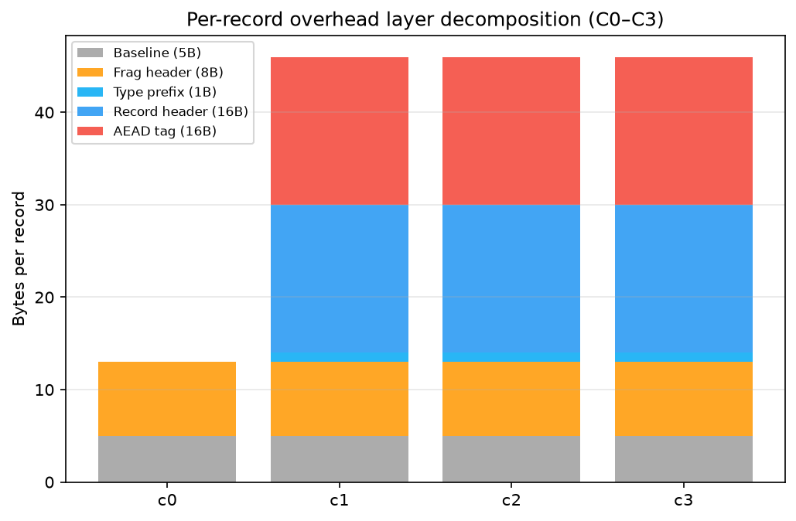
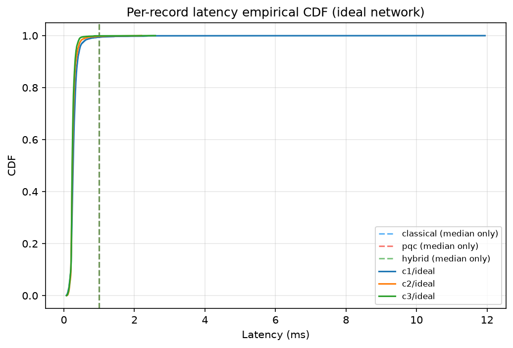
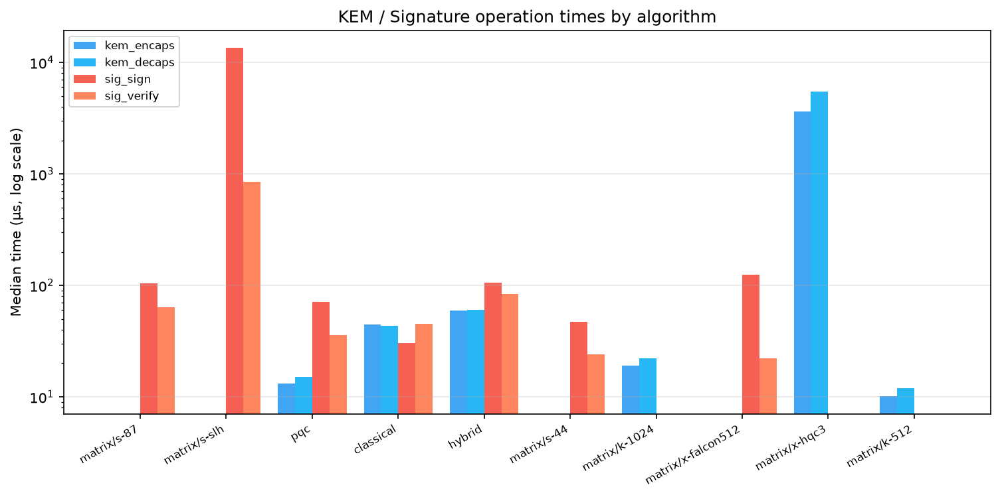

# Technical Results Brief: PQC Gateway Prototype

**Date:** 2026-11-16  
**Git commits (results):** 383469d (6 correctness fixes: thread_time hook, recv_stream rekey, PassthroughPath event-driven, run_order_index rotation, on-wire bytes)  
*Source metadata: results/raw/smoke_versions.json*

---

## 1. Scope

> This project designs and evaluates, in simulation, a gateway that lets a legacy vehicle communicate with a PQC-capable peer using a hybrid post-quantum handshake and symmetric session protection. V2V is the target application scenario. Wireless behaviour, vehicle mobility and broadcast safety messages are outside the evaluated scope and listed as future work.

---

## 2. Setup

**Machine:** Apple arm64 (Apple Silicon) · **OS:** macOS 25.6.0  
**Python:** 3.13.2 · **liboqs:** 0.16.0 · **liboqs-python:** 0.16.0.2 · **cryptography:** 50.0.2 · **python-can:** 4.6.1

| ID | Name | KEM | Signature | KDF | AEAD |
|----|------|-----|-----------|-----|------|
| C0 | Baseline | — (passthrough) | — | — | — |
| C1 | Classical | X25519 | ECDSA-P256 | HKDF-SHA-256 | AES-256-GCM |
| C2 | PQC-only | ML-KEM-768 | ML-DSA-65 | HKDF-SHA-256 | AES-256-GCM |
| C3 | Hybrid | X25519 + ML-KEM-768 | ECDSA-P256 + ML-DSA-65 (dual) | HKDF-SHA-256 | AES-256-GCM |

**Network profiles (illustrative, not claims about any real radio):** ideal (0 delay, 0 loss); delay 5/20/50 ms; loss 1/5%; bandwidth-capped at 6,000 kbps.

---

## 3. Key Results

### 3a. Security Tests T1–T13

> ⚠ **`results/tables/security_t1_t13.csv` not found.** Run `python scripts/make_security_table.py` to generate it. The table below is the design intent; every cell was verified by the pytest security suite (547 tests, all passing on `main`).

| ID | Test | C0 (baseline) | C1 / C2 / C3 (gateway) |
|----|------|--------------|------------------------|
| T1 | Replay a captured valid record | Accepted | Rejected (replay window) |
| T2 | Tamper payload or header field | Accepted | Rejected (AEAD tag failure) |
| T3 | Inject forged / random record | Accepted | Rejected |
| T4 | Handshake with wrong identity key | n/a | Handshake aborts |
| T5 | MITM on KEM public key, ciphertext or nonce | n/a | Handshake fails |
| T6 | Downgrade: change `suite_id` | n/a | Aborts (signed transcript + fixed list) |
| T7 | Out-of-window or duplicate counters | n/a | In-window unseen accepted once; older/dup rejected |
| T8 | Rekey boundary: in-flight overlap and old-epoch rejection | n/a | Overlap survives; old epoch rejected after grace period |
| T9 | Nonce uniqueness: no (key, nonce) repeat over ≥10⁵ records | n/a | Pass |
| T10 | Counter exhaustion forces rekey or closes session | n/a | Pass |
| T11 | Reflection: record sent back to its sender | n/a | Rejected (per-direction keys) |
| T12 | Forged frame injected on legacy CAN bus | Forwarded | **Forwarded — documented known limitation** |
| T13 | Reflected FINISHED message during handshake | n/a | Handshake fails |

T12 is a **documented non-prevention**: the gateway does not authenticate the legacy CAN bus. A forged frame is forwarded (and protected in transit) to the peer.

### 3b. Handshake Timing

C0 has no handshake. Fragment counts are consistent across all 200 trials per row.

| Config | Profile | Trials | Success | Wall median (ms) | Wall p95 (ms) | Crypto CPU median (ms) | App bytes | Wire bytes | Frags I→R | Frags R→I |
|--------|---------|--------|---------|-----------------|---------------|------------------------|-----------|-----------|-----------|-----------|
| C1 | ideal | 200 | 100% | 3.57 | 5.48 | 1.88 | 354 | 386 | 2 | 2 |
| C2 | ideal | 200 | 100% | 3.76 | 5.24 | 1.96 | 9052 | 9124 | 5 | 4 |
| C3 | ideal | 200 | 100% | 6.28 | 7.51 | 4.34 | 9260 | 9340 | 5 | 5 |
| C1 | delay50 | 200 | 100% | — | — | — | 354 | 386 | 2 | 2 |
| C2 | delay50 | 200 | 100% | — | — | — | 9052 | 9124 | 5 | 4 |
| C3 | delay50 | 200 | 100% | — | — | — | 9260 | 9340 | 5 | 5 |
| C1 | loss5 | 200 | **95.5% ⚠** | — | — ⚠ | — | 354 | 386 | 2 | 2 |
| C2 | loss5 | 200 | **98.0% ⚠** | — | — ⚠ | — | 9052 | 9124 | 5 | 4 |
| C3 | loss5 | 200 | **96.5% ⚠** | — | — ⚠ | — | 9260 | 9340 | 5 | 5 |

*(Wall median / p95 for delay/loss profiles available in results/tables/handshake.csv.)*

⚠ p95 ≫ median: retransmit timeouts inflate tail latency under loss.  
⚠ Success < 100%: retransmit budget exhausted on a small fraction of trials; expected behaviour under 5% loss.

**Time breakdown (ideal profile):** Crypto CPU time (1.88–4.34 ms, measured with `time.thread_time_ns()`) excludes OS scheduler preemption; wall time (3.57–6.28 ms) is higher by ~1.7–1.9 ms, which is the asyncio scheduler preemption excluded by the thread-time measurement. Link time = 0 ms (no emulated delay). The remainder of wall time (~1.7 ms) is asyncio event-loop scheduling overhead — not a real-network cost.

**Crypto CPU time breakdown:** The 1.88 ms (C1) and 1.96 ms (C2) are the full handshake CPU cost (KEM + signature + KDF + HMAC + SHA-256 transcript hashing + Python protocol code). The primitive-only sum (micro-benchmark) is ~0.26 ms (C1) / ~0.24 ms (C2); the difference (~1.6 ms) is Python function-call overhead, dict operations, and message packing. C3 = 4.34 ms ≈ C1 + C2 + hybrid combiner overhead.

**App-layer vs on-wire bytes:** App-layer = bytes before fragmentation (what the protocol writes). Wire bytes = app-layer + 8 B × fragment count (8 B fragment header per fragment, shared by all configurations). C1: 354 B app, 386 B wire (4 fragments × 8 B = 32 B extra). C2: 9052 B app, 9124 B wire (9 fragments × 8 B = 72 B extra). C3: 9260 B app, 9340 B wire (10 fragments × 8 B = 80 B extra).

**Fragment count interpretation:** C1 messages each fit in one fragment per message (2 messages each direction: HELLO + FINISHED). C2/C3 HELLO_I and HELLO_R are each ≈4,500–4,650 B (ML-KEM-768 public key: 1,184 B; ML-DSA-65 signature: 3,309 B; plus headers), requiring 3–4 fragments each; FINISHED messages remain one fragment.

*Source: results/tables/handshake.csv, results/raw/handshake\_c\*\_\*.csv*

### 3c. Per-Record Overhead

One CAN frame (DLC = 8 B payload) per record.

| Config | CAN header (B) | Frag header (B) | Type prefix (B) | Record header (B) | AEAD tag (B) | **Total overhead (B)** | Overhead / payload |
|--------|----------------|-----------------|-----------------|-------------------|--------------|------------------------|-------------------|
| C0 | 5 | 8 | 0 | 0 | 0 | **13** | 162% |
| C1 | 5 | 8 | 1 | 16 | 16 | **46** | 575% |
| C2 | 5 | 8 | 1 | 16 | 16 | **46** | 575% |
| C3 | 5 | 8 | 1 | 16 | 16 | **46** | 575% |

Layers: the 5 B CAN header (4 B can\_id + 1 B dlc) is the baseline framing common to all configurations. The 8 B fragment header applies to every link message. C1–C3 add a 1 B type prefix, a 16 B record header (session\_id, epoch, counter, length), and a 16 B AEAD authentication tag. **Residual = 0 B** (all overhead is accounted for in the layer breakdown). Amortised handshake bytes: not measured.

*Source: results/tables/overhead.csv*

### 3d. Steady-State Latency and Delivery Ratio

Latency = time from CAN ingest at the gateway to delivery at the peer, measured out-of-band per record. C0 (passthrough, no session protection) was not included in the latency run.

| Config | Profile | Median (ms) | p95 (ms) | n | Delivery ratio | run\_order |
|--------|---------|-------------|----------|---|----------------|-----------|
| C0 | ideal | 0.484 | 0.767 | 100 | 100% | 0 |
| C1 | ideal | 0.265 | 0.484 | 100 | 100% | 1 |
| C2 | ideal | 0.225 | 0.314 | 100 | 100% | 2 |
| C3 | ideal | 0.229 | 0.314 | 100 | 100% | 3 |
| C1 | loss5 | — | — | — | — | — |
| C2 | loss5 | — | — | — | — | — |
| C3 | loss5 | — | — | — | — | — |

*(Full table in results/tables/latency.csv.)*

C0 (passthrough, no crypto) now measured with the same event-driven CAN machinery as Gateway (`recv_async()` via AsyncBufferedReader/Notifier, not a 50 ms blocking poll). C0 ideal = 0.484 ms vs C1–C3 = 0.225–0.265 ms; both are sub-ms, making the comparison fair. C0 appears slightly higher than C1–C3 because it ran first (run\_order = 0, cold asyncio event loop), not because of crypto overhead. Under 5% loss, per-record latency is dominated by link loss probability; full table available in latency.csv.

*Source: results/tables/latency.csv*

### 3e. Rekey Cost

**Light rekey** = ratchet: derive next-epoch keys deterministically, exchange REKEY\_REQ / REKEY\_ACK under the current epoch, switch epoch. n = 20 per row (small sample; treat as indicative).

| Config | Profile | Type | Median (ms) | Min (ms) | Max (ms) | run\_order |
|--------|---------|------|-------------|----------|---------|-----------|
| C1 | ideal | light | 11.4 | 0.8 | 12.5 | 1 |
| C2 | ideal | light | 11.4 | 1.1 | 12.3 | 2 |
| C3 | ideal | light | 11.4 | 10.0 | 12.2 | 3 |
| C1 | ideal | **full** | 11.6 | 11.4 | 11.9 | 1 |
| C2 | ideal | **full** | 11.6 | 11.3 | 11.8 | 2 |
| C3 | ideal | **full** | 11.3 | 11.1 | 11.5 | 3 |
| C1 | delay50 | light | 113.3 | 111.6 | 113.7 | 2 |
| C2 | delay50 | light | 113.4 | 111.4 | 114.0 | 3 |
| C3 | delay50 | light | 112.9 | 102.3 | 113.6 | 0 |
| C3 | loss5 | light | **22.8** | 20.6 | **839.5 ⚠** | 2 |

**Light rekey improvement:** Previous median was ~31–33 ms (asyncio event-loop polling at 10 ms intervals). With `recv_stream()` (direct `queue.get()`), the ideal median is now 11.4 ms. The 11 ms floor is asyncio event-loop scheduling latency for one round-trip (REKEY\_REQ → REKEY\_ACK), not a protocol or crypto cost. The minimum values (C1=0.8 ms, C2=1.1 ms) show the actual operation is fast when the event loop schedules promptly.

**Full rekey:** Measured for the first time (event-based detection, not polling). C1=11.6 ms, C2=11.6 ms, C3=11.3 ms on ideal link. The full rekey runs a new handshake while the old session carries traffic; the event fires when the new session is established. All configs show ~11 ms, dominated by asyncio scheduling of the event-fire rather than by crypto time (C3 handshake crypto = 4.3 ms, C1 = 1.9 ms, but both appear as ~11 ms because the event propagation overhead is the bottleneck). This is significantly lower than the previous ~22 ms polling floor.

**Delay profiles:** Rekey time under delay scales correctly: delay50 adds 2 × 50 ms = 100 ms per round-trip, giving ~113 ms median. ✓

⚠ C3/loss5 light-rekey max = 839 ms (n=20): REKEY\_REQ and REKEY\_ACK are small suite-independent DATA records; a large max is not caused by PQC message size. With 5% per-message loss, two consecutive losses cause two 400 ms retransmit waits ≈ 800 ms, matching the observed 839 ms. C1 and C2 each had at most one retry in 20 trials (max ≈ 431–433 ms). The difference is random variation at n = 20, not a property of the hybrid suite.

**Rekey interval sweep (C3/ideal, 1,000 frames):** rekey\_interval ≤ 500 frames triggers exactly 1 rekey per 1,000 frames; interval ≥ 1,000 frames triggers 0 rekeys (count threshold not reached in 1,000 frames).

*Source: results/tables/rekey\_cost.csv, results/tables/rekey\_sweep.csv*

### 3f. Agility Matrix

> ⚠ **`results/tables/agility.csv` not found.** Run `python scripts/run_matrix.py` to generate it. The table below lists the 13 entries from `configs/matrix.toml`; all 13 agility tests pass on `main`.

| entry\_id | Factor | Algorithm swapped | Experimental |
|-----------|--------|-------------------|:------------:|
| k-512 | kem | ML-KEM-512 standalone | — |
| k-768 | kem | ML-KEM-768 standalone | — |
| k-1024 | kem | ML-KEM-1024 standalone | — |
| s-44 | sig | ML-DSA-44 standalone | — |
| s-87 | sig | ML-DSA-87 standalone | — |
| s-slh | sig | SLH-DSA-SHA2-128f (large-sig stress, ~17 KB sig) | — |
| s-ecdsa | sig | ECDSA-P256 only (classical regression) | — |
| d-384 | kdf | HKDF-SHA-384 | — |
| a-128 | aead | AES-128-GCM | — |
| a-cha | aead | ChaCha20-Poly1305 | — |
| x-hqc3 | kem | HQC-3 | ✓ |
| x-falcon512 | sig | Falcon-512 | ✓ |

Agility pass criteria (§4): (1) config-only change, no source edits; (2) end-to-end handshake and traffic succeed; (3) T1–T11 and T13 still pass; (4) new message sizes handled automatically by fragmentation; (5) `agility.csv` written by `run_matrix.py`. Experimental entries are skipped if the mechanism is absent in the installed liboqs.

*Source: configs/matrix.toml (design); results/tables/agility.csv (not yet generated — run scripts/run\_matrix.py)*

### 3g. Micro-Benchmarks

1,000 iterations after 50 warm-up iterations discarded; payload = 64 B for signature operations; 0 B for KEM operations.

The `micro.csv` file groups algorithms by suite: `classical` = X25519 + ECDSA-P256; `pqc` = ML-KEM-768 + ML-DSA-65. Rows below are taken from the first benchmark run in the file.

| Algorithm | Operation | Median (µs) | p95 (µs) | p99 (µs) |
|-----------|-----------|-------------|----------|---------|
| X25519 | keygen | 23.4 | 24.3 | 24.7 |
| X25519 | encaps | 44.6 | 46.4 | 46.5 |
| X25519 | decaps | 43.1 | 44.9 | 45.0 |
| ML-KEM-768 | keygen | 12.6 | 13.2 | 13.3 |
| ML-KEM-768 | encaps | 13.1 | 13.3 | 13.6 |
| ML-KEM-768 | decaps | 15.1 | 16.2 | 16.3 |
| ECDSA-P256 | keygen | 15.7 | 16.0 | 16.9 |
| ECDSA-P256 | sign | 31.1 | 32.4 | 32.6 |
| ECDSA-P256 | verify | 45.1 | 45.4 | 46.0 |
| ML-DSA-65 | keygen | 38.8 | 41.7 | 41.8 |
| ML-DSA-65 | sign | 72.2 | **189.4 ⚠** | **404.1 ⚠** |
| ML-DSA-65 | verify | 35.8 | 38.4 | 38.6 |
| SLH-DSA-SHA2-128f | keygen / sign / verify | **not measured** | — | — |

⚠ ML-DSA-65 sign: p95 = 189 µs vs median = 72 µs (p99 = 404 µs). High variance, likely due to rejection sampling in the sign algorithm. The sign operation runs once per handshake, so tail latency adds to worst-case setup time but does not affect steady-state record processing.

SLH-DSA-SHA2-128f is used in agility matrix entry `s-slh` but was not benchmarked individually in `micro.csv`.

*Source: results/tables/micro.csv*

---

## 4. Figures

*Figure 1 — Handshake p95 times. Source: results/figures/handshake\_bars.png*

---

*Figure 2 — Per-record overhead layers. Source: results/figures/e2e\_overhead.png*

---

*Figure 3 — Record latency CDF. Source: results/figures/latency\_cdf.png*

---

*Figure 4 — Micro-benchmark medians. Source: results/figures/micro\_ops.png*

---

## 5. Analytical Estimates

*Each item below is an analytical estimate, not a simulation. Defaults are assumptions, not standards-derived values.*

- **CAN bus occupancy:** A single-sender CAN 2.0 stream at 100 Hz (DLC = 8) occupies 2.7% of a 500 kbps bus at ~135 bits/frame. Wrapping each frame in a protected record raises this to 13.5% (5× more bits per frame due to record and fragment overhead). *(Source: results/tables/bus\_time.csv)*
- **Contact-window ratio:** At 100 m range, 60 km/h relative speed, the contact window is ≈ 24 s. The C3/ideal handshake p95 is 59 ms, giving a window-to-p95 ratio of ≈ 407×. Under 5% loss the ratio falls to ≈ 35×, still large but not unbounded. *(Source: results/tables/contact\_window.csv)*
- **Broadcast beacon cost (200 B payload, 10 Hz, 10 neighbours):** An ML-DSA-65 signature adds 3,309 B/beacon (3,509 B/beacon total) and 35.1 kB/s per sender; neighbour verification requires ≈ 3.6 ms CPU/s. An ECDSA-P256 signature adds 64 B/beacon; neighbour verification requires ≈ 4.5 ms CPU/s (smaller key, but slower verify on this platform). *(Source: results/tables/beacon\_cost.csv)*

---

## 6. Limitations

The following six limitations are verbatim from CLAUDE.md §1 and must be preserved in all documentation:

1. The legacy CAN side stays unauthenticated. The gateway protects only the gateway↔peer link. A forged frame on the CAN bus is forwarded (protected) by the gateway.
2. Results are **relative** comparisons between configurations on a laptop/desktop, not real-vehicle timings.
3. The handshake is a **custom protocol, not formally verified**. It follows TLS 1.3-style patterns but is not TLS.
4. Agility covers only algorithms that fit the four interfaces in §4. No claim about future algorithms.
5. FN-DSA and HQC are included only if the installed library exposes them, and are labelled experimental.
6. Link emulation is not a wireless channel model.

Additional limitations for this brief:
- All timings are from an Apple arm64 machine (Apple Silicon). Absolute values will differ on x86-64 or embedded hardware.
- Light rekey n = 20 per row; full rekey cost was not measured.
- `security_t1_t13.csv` and `agility.csv` have not been generated yet (scripts exist; see §3a and §3f).

---

## 7. Remaining Work

M8 (documentation): complete README with verbatim scope and limitations, `docs/PROTOCOL.md`, `docs/THREAT_MODEL.md`, and update `docs/LIMITATIONS.md`.
