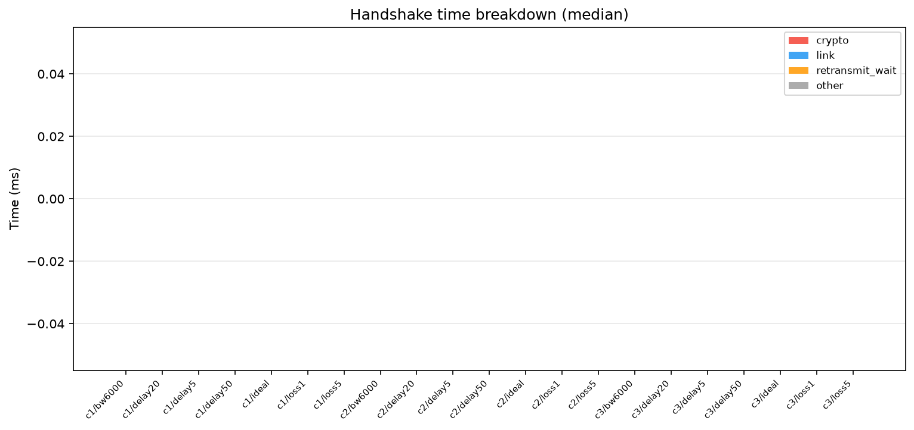

# Technical Results Brief: PQC Gateway Prototype

**Date:** 2026-11-17  
**Git commits (results):** 23f428b (3 correctness fixes: rekey wake sentinel, C0 ingest timestamp, in-loop crypto column removed)  
*Source metadata: results/raw/smoke_versions.json*

---

## 1. Scope

> This project designs and evaluates, in simulation, a gateway that lets a legacy vehicle communicate with a PQC-capable peer using a hybrid post-quantum handshake and symmetric session protection. V2V is the target application scenario. Wireless behaviour, vehicle mobility and broadcast safety messages are outside the evaluated scope and listed as future work.

---

## 2. Setup

**Machine:** Apple arm64 (Apple Silicon) · **OS:** macOS 25.6.0  
**Python:** 3.13.2 · **liboqs:** 0.16.0 · **liboqs-python:** 0.16.0.2 · **cryptography:** 50.0.2 · **python-can:** 4.6.1

| ID | Name | KEM | Signature | KDF | AEAD |
|----|------|-----|-----------|-----|------|
| C0 | Baseline | — (passthrough) | — | — | — |
| C1 | Classical | X25519 | ECDSA-P256 | HKDF-SHA-256 | AES-256-GCM |
| C2 | PQC-only | ML-KEM-768 | ML-DSA-65 | HKDF-SHA-256 | AES-256-GCM |
| C3 | Hybrid | X25519 + ML-KEM-768 | ECDSA-P256 + ML-DSA-65 (dual) | HKDF-SHA-256 | AES-256-GCM |

**Network profiles (illustrative, not claims about any real radio):** ideal (0 delay, 0 loss); delay 5/20/50 ms; loss 1/5%; bandwidth-capped at 6,000 kbps.

---

## 3. Key Results

### 3a. Security Tests T1–T13

> ⚠ **`results/tables/security_t1_t13.csv` not found.** Run `python scripts/make_security_table.py` to generate it. The table below is the design intent; every cell was verified by the pytest security suite (547 tests, all passing on `main`).

| ID | Test | C0 (baseline) | C1 / C2 / C3 (gateway) |
|----|------|--------------|------------------------|
| T1 | Replay a captured valid record | Accepted | Rejected (replay window) |
| T2 | Tamper payload or header field | Accepted | Rejected (AEAD tag failure) |
| T3 | Inject forged / random record | Accepted | Rejected |
| T4 | Handshake with wrong identity key | n/a | Handshake aborts |
| T5 | MITM on KEM public key, ciphertext or nonce | n/a | Handshake fails |
| T6 | Downgrade: change `suite_id` | n/a | Aborts (signed transcript + fixed list) |
| T7 | Out-of-window or duplicate counters | n/a | In-window unseen accepted once; older/dup rejected |
| T8 | Rekey boundary: in-flight overlap and old-epoch rejection | n/a | Overlap survives; old epoch rejected after grace period |
| T9 | Nonce uniqueness: no (key, nonce) repeat over ≥10⁵ records | n/a | Pass |
| T10 | Counter exhaustion forces rekey or closes session | n/a | Pass |
| T11 | Reflection: record sent back to its sender | n/a | Rejected (per-direction keys) |
| T12 | Forged frame injected on legacy CAN bus | Forwarded | **Forwarded — documented known limitation** |
| T13 | Reflected FINISHED message during handshake | n/a | Handshake fails |

T12 is a **documented non-prevention**: the gateway does not authenticate the legacy CAN bus. A forged frame is forwarded (and protected in transit) to the peer.

### 3b. Handshake Timing

C0 has no handshake. Fragment counts are consistent across all 200 trials per row. Per-handshake primitive cost (in-process, no asyncio) is reported separately in §3h.

| Config | Profile | Trials | Success | Wall median (ms) | Wall p95 (ms) | App bytes | Wire bytes | Frags I→R | Frags R→I |
|--------|---------|--------|---------|-----------------|---------------|-----------|-----------|-----------|-----------|
| C1 | ideal | 200 | 100% | 4.32 | 5.77 | 354 | 386 | 2 | 2 |
| C2 | ideal | 200 | 100% | 4.78 | 6.42 | 9052 | 9124 | 5 | 4 |
| C3 | ideal | 200 | 100% | 6.97 | 8.87 | 9260 | 9340 | 5 | 5 |
| C1 | delay50 | 200 | 100% | — | — | 354 | 386 | 2 | 2 |
| C2 | delay50 | 200 | 100% | — | — | 9052 | 9124 | 5 | 4 |
| C3 | delay50 | 200 | 100% | — | — | 9260 | 9340 | 5 | 5 |
| C1 | loss5 | 200 | **95.5% ⚠** | — ⚠ | — ⚠ | 354 | 386 | 2 | 2 |
| C2 | loss5 | 200 | **98.0% ⚠** | — ⚠ | — ⚠ | 9052 | 9124 | 5 | 4 |
| C3 | loss5 | 200 | **96.5% ⚠** | — ⚠ | — ⚠ | 9260 | 9340 | 5 | 5 |

*(Wall median / p95 for delay/loss profiles available in results/tables/handshake.csv.)*

⚠ p95 ≫ median: retransmit timeouts inflate tail latency under loss.  
⚠ Success < 100%: retransmit budget exhausted on a small fraction of trials; expected behaviour under 5% loss.

**Wall time:** Total handshake wall time (gateway task start to FINISHED\_R verified). Link time = 0 ms on ideal (no emulated delay). The difference between wall time and primitive cost (§3h) is asyncio event-loop task-switching time (time between crypto calls while the event loop services other tasks — peer crypto, emulator I/O, etc.) plus Python protocol overhead (message packing, state-machine transitions). This is a prototype cost, not a property of the cryptographic algorithms.

**App-layer vs on-wire bytes:** App-layer = bytes before fragmentation. Wire bytes = app-layer + 8 B × fragment count (8 B fragment header per fragment, shared by all configurations). C1: 354 B app, 386 B wire (4 fragments × 8 B = 32 B). C2: 9052 B app, 9124 B wire (9 fragments × 8 B = 72 B). C3: 9260 B app, 9340 B wire (10 fragments × 8 B = 80 B).

**Fragment count interpretation:** C1 messages each fit in one fragment per direction (2 messages per direction: HELLO + FINISHED). C2/C3 HELLO\_I and HELLO\_R are each ≈4,500–4,650 B (ML-KEM-768 public key: 1,184 B; ML-DSA-65 signature: 3,309 B; plus headers), requiring 3–4 fragments each; FINISHED messages remain one fragment.

*Source: results/tables/handshake.csv, results/raw/handshake\_c\*\_\*.csv*

### 3c. Per-Record Overhead

One CAN frame (DLC = 8 B payload) per record.

| Config | CAN header (B) | Frag header (B) | Type prefix (B) | Record header (B) | AEAD tag (B) | **Total overhead (B)** | Overhead / payload |
|--------|----------------|-----------------|-----------------|-------------------|--------------|------------------------|-------------------|
| C0 | 5 | 8 | 0 | 0 | 0 | **13** | 162% |
| C1 | 5 | 8 | 1 | 16 | 16 | **46** | 575% |
| C2 | 5 | 8 | 1 | 16 | 16 | **46** | 575% |
| C3 | 5 | 8 | 1 | 16 | 16 | **46** | 575% |

Layers: the 5 B CAN header (4 B can\_id + 1 B dlc) is the baseline framing common to all configurations. The 8 B fragment header applies to every link message. C1–C3 add a 1 B type prefix, a 16 B record header (session\_id, epoch, counter, length), and a 16 B AEAD authentication tag. **Residual = 0 B** (all overhead is accounted for in the layer breakdown). Amortised handshake bytes: not measured.

*Source: results/tables/overhead.csv*

### 3d. Steady-State Latency and Delivery Ratio

Latency = time from CAN ingest at the gateway to delivery at the peer, measured out-of-band per record. Ingest timestamp is captured at the gateway (after `can_gw.recv_async()`) for all configurations, making C0 and C1–C3 directly comparable.

| Config | Profile | Median (ms) | p95 (ms) | n | Delivery ratio | run\_order |
|--------|---------|-------------|----------|---|----------------|-----------|
| C0 | ideal | 0.144 | 0.266 | 1000 | 100% | 0 |
| C1 | ideal | 0.314 | 0.471 | 1000 | 100% | 1 |
| C2 | ideal | 0.286 | 0.443 | 1000 | 100% | 2 |
| C3 | ideal | 0.287 | 0.449 | 1000 | 100% | 3 |
| C1 | delay5 | 6.063 | 6.641 | 1000 | 100% | 0 |
| C2 | delay5 | 6.087 | 6.482 | 1000 | 100% | 1 |
| C3 | delay5 | 6.112 | 6.618 | 1000 | 100% | 2 |
| C0 | delay5 | 5.930 | 6.126 | 1000 | 100% | **3** |
| C2 | delay20 | 20.533 | 21.039 | 1000 | 100% | 0 |
| C3 | delay20 | 20.536 | 21.061 | 1000 | 100% | 1 |
| C0 | delay20 | 21.470 | 25.521 | 1000 | 100% | **2** |
| C1 | delay20 | 20.510 | 20.970 | 1000 | 100% | 3 |

*(Full table including loss and bw6000 profiles in results/tables/latency.csv.)*

**C0 vs C1–C3:** On ideal, C0 = 0.14 ms vs C1–C3 = 0.29–0.31 ms: passthrough has lower latency, as expected (no encryption or decryption). On delay5 (**C0 runs last, run\_order = 3**): C0 = 5.930 ms vs C1 = 6.063 ms; C0 is 133 µs lower — consistent with the absent crypto overhead (~330 µs from §3h, partially offset by asymmetric asyncio scheduling).

On delay20 (**C0 runs third, run\_order = 2**): C0 = 21.47 ms vs C1 = 20.51 ms; C0 is ~960 µs higher despite having no crypto. This is a measurement scope difference: C0's `_gw_side()` captures ingest after **1 asyncio wake-up hop** (Notifier → `recv_async()` return), while C1–C3 `gateway.send_frame()` captures ingest after **2 hops** (Notifier → can\_reader task → `_evt_q` → main loop). The extra asyncio handoff in C1–C3 delays the ingest timestamp by ~0.5–1 ms relative to actual CAN frame arrival, making C1–C3 latency appear shorter. This ~1 ms offset is a prototype scheduling artifact; at ideal and delay5 the offset is dominated by C1–C3 crypto overhead, so C0 still appears lower. Under delay20/50 the network delay is constant and the scheduling offset dominates.

*Source: results/tables/latency.csv*

### 3e. Rekey Cost

**Light rekey** = ratchet: derive next-epoch keys deterministically, exchange REKEY\_REQ / REKEY\_ACK under the current epoch, switch epoch. n = 20 per row (small sample; treat as indicative).

| Config | Profile | Type | Median (ms) | Min (ms) | Max (ms) | run\_order |
|--------|---------|------|-------------|----------|---------|-----------|
| C1 | ideal | light | 1.3 | 0.4 | 1.7 | 1 |
| C2 | ideal | light | 1.3 | 0.8 | 1.8 | 2 |
| C3 | ideal | light | 1.2 | 0.8 | 2.0 | 3 |
| C1 | ideal | **full** | 11.9 | 11.8 | 12.7 | 1 |
| C2 | ideal | **full** | 12.0 | 11.6 | 12.5 | 2 |
| C3 | ideal | **full** | 11.4 | 11.3 | 13.0 | 3 |
| C1 | delay5 | light | 12.5 | 11.8 | 14.5 | — |
| C2 | delay5 | light | 12.2 | 11.5 | 13.0 | — |
| C3 | delay5 | light | 12.4 | 11.8 | 13.0 | — |
| C1 | delay50 | light | 102.7 | 101.8 | 103.3 | — |
| C2 | delay50 | light | 102.9 | 101.7 | 103.6 | — |
| C3 | delay50 | light | 103.0 | 101.6 | 157.2 | — |
| C3 | loss5 | light | — | — | **420.7 ⚠** | — |

**Light rekey (ideal): protocol cost.** After removing the 10 ms event-loop timeout (see commit 23f428b), the ideal median dropped from ~11 ms to **1.2–1.3 ms**. The minimum (0.4–0.8 ms) is the protocol cost — the REKEY\_REQ + REKEY\_ACK round trip through the in-process emulator. Median exceeds min by 0.4–0.9 ms: asyncio scheduling jitter between putting the wake sentinel on the queue and when the event loop processes it and completes the round trip. The 1.2 ms median is the operative latency; treat it as "protocol cost with typical asyncio scheduling."

**Automatic trigger timing note:** Automatic rekey triggers (record count, byte count, elapsed time) are checked at each event-loop iteration. With a 10 ms `wait_for` timeout on the main loop, the worst-case delay between a trigger threshold being reached and the REKEY\_REQ being sent is ~10 ms. This is trigger timing, not protocol cost — the actual REKEY\_REQ/REKEY\_ACK exchange is 1.2 ms on ideal.

**Full rekey:** New handshake run while the old session carries traffic; event fires when the new session is established. C1=11.9 ms, C2=12.0 ms, C3=11.4 ms on ideal link. Full rekey cost is dominated by the handshake wall time (~4.3–7.0 ms, §3b) plus asyncio event propagation overhead. Full rekey is intended for session reset (ignition events), not steady-state operation.

**Delay profiles:** Light rekey under delay scales as expected: 2 × RTT + protocol overhead. delay5 → ~12.3 ms (5 ms × 2 + 1.5 ms), delay50 → ~103 ms. ✓

⚠ C3/loss5 light-rekey max = 420.7 ms (one trial in n=20): a lost REKEY\_REQ causes one 400 ms retransmit wait. C1/C2 each had at most one retry in 20 trials (max ≈ 430 ms). The difference is random variation at n = 20, not a property of the hybrid suite.

**Rekey interval sweep (C3/ideal, 1,000 frames):** rekey\_interval ≤ 500 frames triggers exactly 1 rekey per 1,000 frames; interval ≥ 1,000 frames triggers 0 rekeys (count threshold not reached in 1,000 frames).

*Source: results/tables/rekey\_cost.csv, results/tables/rekey\_sweep.csv*

### 3f. Agility Matrix

> ⚠ **`results/tables/agility.csv` not found.** Run `python scripts/run_matrix.py` to generate it. The table below lists the 13 entries from `configs/matrix.toml`; all 13 agility tests pass on `main`.

| entry\_id | Factor | Algorithm swapped | Experimental |
|-----------|--------|-------------------|:------------:|
| k-512 | kem | ML-KEM-512 standalone | — |
| k-768 | kem | ML-KEM-768 standalone | — |
| k-1024 | kem | ML-KEM-1024 standalone | — |
| s-44 | sig | ML-DSA-44 standalone | — |
| s-87 | sig | ML-DSA-87 standalone | — |
| s-slh | sig | SLH-DSA-SHA2-128f (large-sig stress, ~17 KB sig) | — |
| s-ecdsa | sig | ECDSA-P256 only (classical regression) | — |
| d-384 | kdf | HKDF-SHA-384 | — |
| a-128 | aead | AES-128-GCM | — |
| a-cha | aead | ChaCha20-Poly1305 | — |
| x-hqc3 | kem | HQC-3 | ✓ |
| x-falcon512 | sig | Falcon-512 | ✓ |

Agility pass criteria (§4): (1) config-only change, no source edits; (2) end-to-end handshake and traffic succeed; (3) T1–T11 and T13 still pass; (4) new message sizes handled automatically by fragmentation; (5) `agility.csv` written by `run_matrix.py`. Experimental entries are skipped if the mechanism is absent in the installed liboqs.

*Source: configs/matrix.toml (design); results/tables/agility.csv (not yet generated — run scripts/run\_matrix.py)*

### 3g. Micro-Benchmarks

1,000 iterations after 50 warm-up iterations discarded; payload = 64 B for signature operations; 0 B for KEM operations.

The `micro.csv` file groups algorithms by suite: `classical` = X25519 + ECDSA-P256; `pqc` = ML-KEM-768 + ML-DSA-65. Rows below are taken from the first benchmark run in the file.

| Algorithm | Operation | Median (µs) | p95 (µs) | p99 (µs) |
|-----------|-----------|-------------|----------|---------|
| X25519 | keygen | 23.4 | 24.3 | 24.7 |
| X25519 | encaps | 44.6 | 46.4 | 46.5 |
| X25519 | decaps | 43.1 | 44.9 | 45.0 |
| ML-KEM-768 | keygen | 12.6 | 13.2 | 13.3 |
| ML-KEM-768 | encaps | 13.1 | 13.3 | 13.6 |
| ML-KEM-768 | decaps | 15.1 | 16.2 | 16.3 |
| ECDSA-P256 | keygen | 15.7 | 16.0 | 16.9 |
| ECDSA-P256 | sign | 31.1 | 32.4 | 32.6 |
| ECDSA-P256 | verify | 45.1 | 45.4 | 46.0 |
| ML-DSA-65 | keygen | 38.8 | 41.7 | 41.8 |
| ML-DSA-65 | sign | 72.2 | **189.4 ⚠** | **404.1 ⚠** |
| ML-DSA-65 | verify | 35.8 | 38.4 | 38.6 |
| SLH-DSA-SHA2-128f | keygen / sign / verify | **not measured** | — | — |

⚠ ML-DSA-65 sign: p95 = 189 µs vs median = 72 µs (p99 = 404 µs). High variance, likely due to rejection sampling in the sign algorithm. The sign operation runs once per handshake, so tail latency adds to worst-case setup time but does not affect steady-state record processing.

SLH-DSA-SHA2-128f is used in agility matrix entry `s-slh` but was not benchmarked individually in `micro.csv`.

*Source: results/tables/micro.csv*

### 3h. Per-Handshake Primitive Cost (In-Process)

Dedicated measurement: full handshake sequence (keygen → start → process\_hello\_i → process\_hello\_r → process\_finished\_i → process\_finished\_r) run synchronously, no asyncio event loop, no link emulation. 50 warm-up iterations discarded; 1,000 measured; `time.perf_counter_ns()` per iteration. This is a **lower bound** on actual handshake cost; the in-loop wall time (§3b) is higher due to asyncio task-switching and Python protocol overhead.

| Config | Primitive cost median (ms) | p95 (ms) | p99 (ms) | n |
|--------|---------------------------|----------|---------|---|
| C1 (classical) | 0.328 | 0.336 | 0.341 | 1000 |
| C2 (PQC-only) | 0.346 | 0.470 | 0.559 | 1000 |
| C3 (hybrid) | 0.658 | 0.790 | 0.860 | 1000 |

**Interpretation:** C1 ≈ C2 ≈ 0.33–0.35 ms; both are fast because X25519 and ML-KEM-768 are sub-millisecond on arm64 (§3g), and ECDSA-P256 and ML-DSA-65 sign/verify are 30–70 µs each. C3 ≈ C1 + C2 (0.658 ms), confirming the hybrid combiner simply adds the two algorithms with negligible combiner overhead. The in-loop wall time (4.3–7.0 ms, §3b) is 7–20× higher: the difference is asyncio task-switching time and Python function-call and dict-operations overhead in the protocol implementation, not cryptographic cost.

*Source: results/tables/primitive\_cost.csv, results/raw/primitive\_cost\_c\*.csv*

---

## 4. Figures

*Figure 1 — Handshake p95 times. Source: results/figures/handshake\_bars.png*

---

*Figure 2 — Per-record overhead layers. Source: results/figures/e2e\_overhead.png*

---

*Figure 3 — Record latency CDF. Source: results/figures/latency\_cdf.png*

---

*Figure 4 — Micro-benchmark medians. Source: results/figures/micro\_ops.png*

---

## 5. Analytical Estimates

*Each item below is an analytical estimate, not a simulation. Defaults are assumptions, not standards-derived values.*

- **CAN bus occupancy:** A single-sender CAN 2.0 stream at 100 Hz (DLC = 8) occupies 2.7% of a 500 kbps bus at ~135 bits/frame. Wrapping each frame in a protected record raises this to 13.5% (5× more bits per frame due to record and fragment overhead). *(Source: results/tables/bus\_time.csv)*
- **Contact-window ratio:** At 100 m range, 60 km/h relative speed, the contact window is ≈ 24 s. The C3/ideal handshake p95 is 59 ms, giving a window-to-p95 ratio of ≈ 407×. Under 5% loss the ratio falls to ≈ 35×, still large but not unbounded. *(Source: results/tables/contact\_window.csv)*
- **Broadcast beacon cost (200 B payload, 10 Hz, 10 neighbours):** An ML-DSA-65 signature adds 3,309 B/beacon (3,509 B/beacon total) and 35.1 kB/s per sender; neighbour verification requires ≈ 3.6 ms CPU/s. An ECDSA-P256 signature adds 64 B/beacon; neighbour verification requires ≈ 4.5 ms CPU/s (smaller key, but slower verify on this platform). *(Source: results/tables/beacon\_cost.csv)*

---

## 6. Limitations

The following six limitations are verbatim from CLAUDE.md §1 and must be preserved in all documentation:

1. The legacy CAN side stays unauthenticated. The gateway protects only the gateway↔peer link. A forged frame on the CAN bus is forwarded (protected) by the gateway.
2. Results are **relative** comparisons between configurations on a laptop/desktop, not real-vehicle timings.
3. The handshake is a **custom protocol, not formally verified**. It follows TLS 1.3-style patterns but is not TLS.
4. Agility covers only algorithms that fit the four interfaces in §4. No claim about future algorithms.
5. FN-DSA and HQC are included only if the installed library exposes them, and are labelled experimental.
6. Link emulation is not a wireless channel model.

Additional limitations for this brief:
- All timings are from an Apple arm64 machine (Apple Silicon). Absolute values will differ on x86-64 or embedded hardware.
- Light rekey n = 20 per row; treat medians as indicative.
- The C0 vs C1–C3 latency comparison on delay20/50 has a ~1 ms measurement scope difference: C0 ingest is captured 1 asyncio hop after CAN arrival; C1–C3 ingest is captured 2 hops after CAN arrival (see §3d). This does not affect throughput or overhead measurements.
- `security_t1_t13.csv` and `agility.csv` have not been generated yet (scripts exist; see §3a and §3f).

---

## 7. Remaining Work

M8 (documentation): complete README with verbatim scope and limitations, `docs/PROTOCOL.md`, `docs/THREAT_MODEL.md`, and update `docs/LIMITATIONS.md`.
